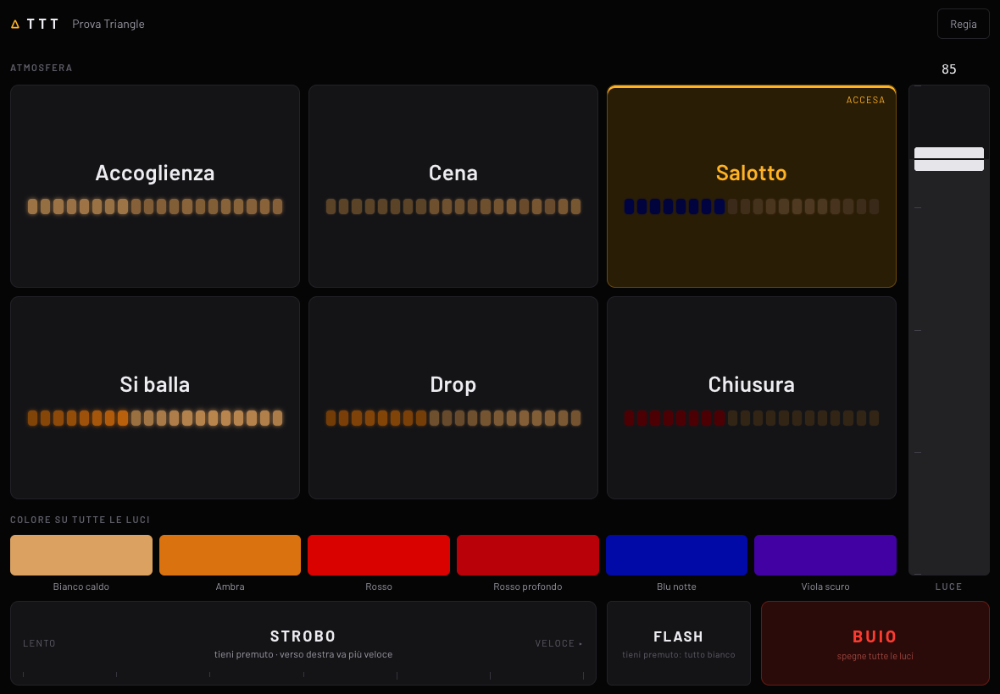
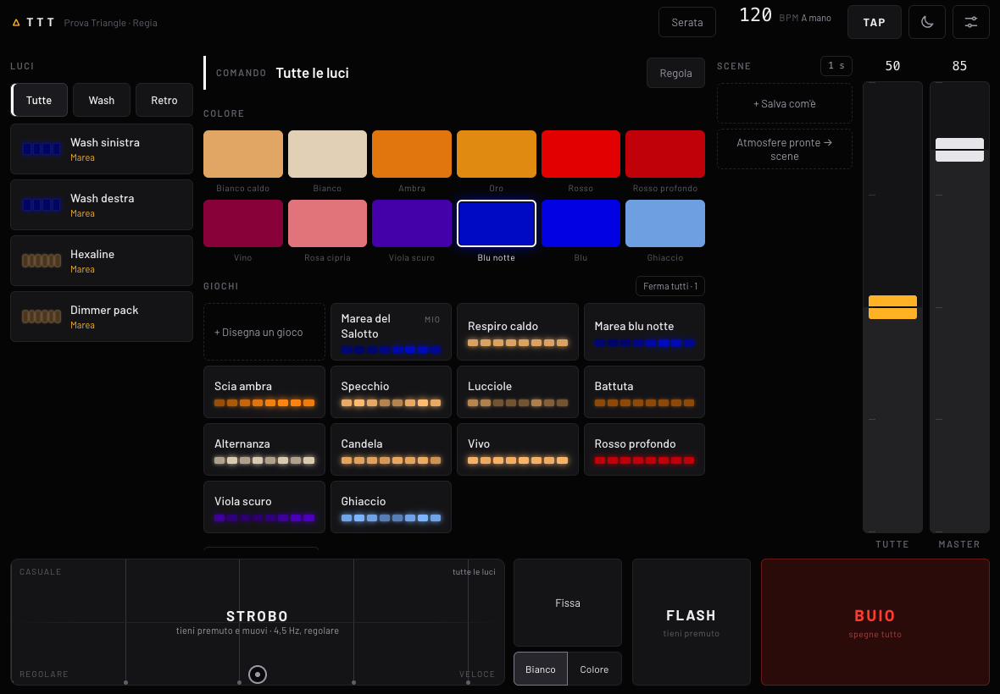
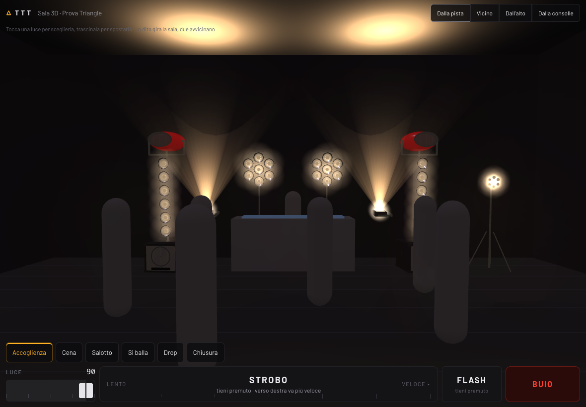

<h1 align="center">△ TTT</h1>

<b>Le luci del tuo locale, dal tablet.</b> 
Un software di Triangle Corporation per locali, eventi e consolle DJ.

  <a href="https://github.com/TriangleCorporation/ttt/releases/latest"><b>Scarica l'ultima versione</b></a> ·
  <a href="docs/manuale.md">Manuale</a> ·
  <a href="CHANGELOG.md">Novità</a> ·
  <a href="mailto:info@trngl.it">Supporto</a>

---

TTT trasforma un computer (Mac, Windows o Linux) in una centrale luci DMX/Art-Net e un iPad o un telefono nel suo telecomando.
Niente console da imparare, niente programmi da configurare la sera stessa: si accende il computer, si apre la pagina sul tablet
e le luci rispondono.

È fatto per chi le luci le usa, non per chi le programma: il barista che alza l'atmosfera quando entra la gente, l'organizzatore
che manda il buio prima dello show, il DJ che vuole lo strobo sul drop.

## Due modalità

**Serata** — quella che si apre da sola, per lo staff. Pochi tasti grandi: le atmosfere della serata (*Accoglienza, Cena, Salotto,
Si balla, Drop, Chiusura*), un colore su tutte le luci, un fader «Luce», lo strobo da tenere premuto, il flash e il buio.
Si impara in trenta secondi e non si rompe niente.

**Regia** — per chi prepara la serata, protetta da un PIN. Ogni luce e ogni pixel, colori, giochi, scene, strobo a pad XY,
tempo dai CDJ, patch e sala 3D.

## Cosa sa fare

- **Giochi soffusi, non da festa di paese.** Respiro, marea, scia, lucciole, specchio, battuta, candela: una tinta per gioco,
  movimenti lenti, mai al buio. Si **disegnano** in Regia scegliendo forma, tinta e tempo, e si salvano col proprio nome.
- **A tempo di musica.** Il tempo arriva dalla **rete Pioneer** (Pro DJ Link: i battiti dei CDJ, con l'«uno» della battuta),
  dal **microfono** del computer o dal tasto **TAP**.
- **Strobo serio.** In Serata si tiene premuto e si va più veloci verso destra; in Regia un pad XY: velocità in orizzontale,
  casualità in verticale, agganciato al BPM.
- **Scene e atmosfere** richiamate con dissolvenza; quelle della Serata si preparano in Regia.
- **Sala 3D.** Le luci vere in una sala simulata, mentre le comandi: per preparare la serata senza luci, o per mostrarla al cliente.
- **Le fixture che usi davvero.** Libreria con Stairville Wild Wash Pro 648 RGBW e le Portman (P1, P1 Mini, P1 EVO, P2 Hexaline,
  P2 EVO, P3 PIX3L, P3 EVO, EVO Element, Mantis), con tutte le modalità dai DMX chart ufficiali; le altre si **importano** da
  QLC+, GDTF (grandMA3), grandMA2, ChamSys MagicQ, Daslight/Sunlite e Open Fixture Library.
- **Leggero e sicuro.** Un solo programma di pochi megabyte, senza installazione, che funziona senza internet. Se il tablet
  perde la rete mentre tieni premuto flash o strobo, si spengono da soli.

## Scarica

Ogni versione ha i suoi download nella pagina [Releases](https://github.com/TriangleCorporation/ttt/releases):

| Sistema | File |
|---|---|
| macOS 11 o successivo (Apple Silicon e Intel) | `ttt-<versione>-macos.zip` |
| Windows 10 / 11 (64 bit) | `ttt-<versione>-windows-x64.zip` |
| Linux (x86-64) | `ttt-<versione>-linux-x64.tar.gz` |
| Linux ARM 64 bit (Raspberry Pi 4/5) | `ttt-<versione>-linux-arm64.tar.gz` — senza tempo dal microfono |

Ogni pacchetto contiene il programma, un evento di esempio e le istruzioni brevi. `SHA256SUMS.txt` serve a controllare che il
file scaricato sia integro.

### Primo avvio

- **Mac** — doppio clic su `ttt`. La prima volta macOS lo blocca perché non è firmato: *Impostazioni di Sistema → Privacy e
  sicurezza → Apri comunque*.
- **Windows** — doppio clic su `ttt.exe`. Se compare «Windows ha protetto il PC»: *Ulteriori informazioni → Esegui comunque*;
  quando Windows lo chiede, consenti l'accesso alle **reti private**.
- **Linux** — `./ttt`.

TTT apre il browser sul computer e scrive l'indirizzo da aprire sul tablet (es. `http://192.168.1.20:8080`). Su iPad:
*Condividi → Aggiungi alla schermata Home*, e si apre a tutto schermo come un'app.

Il resto è nel [manuale](docs/manuale.md): collegare il nodo Art-Net, il patch delle luci, la Serata, la Regia, i giochi,
il tempo dai CDJ, la sala 3D, l'import delle fixture e i problemi più comuni.

## Cosa serve

- un computer Mac, Windows o Linux (va bene anche un portatile di qualche anno fa, o un Raspberry Pi 4/5);
- un **nodo Art-Net** (DMX via rete) collegato al computer con un cavo di rete, e le luci collegate al nodo in DMX;
- un iPad o un telefono sulla stessa rete Wi-Fi del computer.

---

TTT è un prodotto di <b>Triangle Corporation S.r.l.</b> · <a href="LICENZA.md">Licenza d'uso</a> ·
<a href="mailto:info@trngl.it">info@trngl.it</a> Pioneer DJ, Pro DJ Link, grandMA, ChamSys, Daslight, QLC+, Stairville e Portman Lights
sono marchi dei rispettivi proprietari; TTT non è affiliato a loro.

