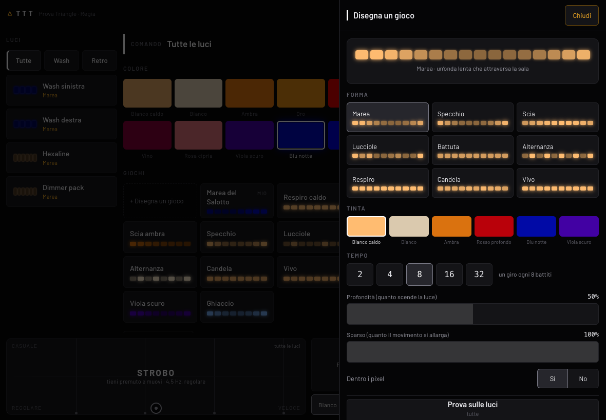

# Manuale di TTT

*Triangle Corporation S.r.l.* · versione del manuale allineata a TTT 0.1

1. [Come funziona](#1-come-funziona)
2. [Installazione e primo avvio](#2-installazione-e-primo-avvio)
3. [Collegare le luci](#3-collegare-le-luci)
4. [L'evento: luci, indirizzi, gruppi](#4-levento-luci-indirizzi-gruppi)
5. [Modalità Serata](#5-modalità-serata)
6. [Modalità Regia](#6-modalità-regia)
7. [Giochi](#7-giochi)
8. [Strobo e flash](#8-strobo-e-flash)
9. [Scene e atmosfere](#9-scene-e-atmosfere)
10. [Il tempo: TAP, CDJ Pioneer, microfono](#10-il-tempo-tap-cdj-pioneer-microfono)
11. [Sala 3D](#11-sala-3d)
12. [Fixture: libreria e import](#12-fixture-libreria-e-import)
13. [Riga di comando](#13-riga-di-comando)
14. [Problemi comuni](#14-problemi-comuni)

---

## 1. Come funziona

```
 iPad / telefono  ──Wi-Fi──▶  computer con TTT  ──cavo di rete──▶  nodo Art-Net  ──DMX──▶  luci
   (i comandi)                 (calcola le luci,                     (traduce in DMX)
                                44 volte al secondo)
```

Tutto il lavoro lo fa il computer: colori, giochi e strobo vengono calcolati lì e mandati al nodo via cavo. Il Wi-Fi porta solo
i tocchi del tablet: se è lento, un comando arriva un attimo dopo, ma le luci non scattano e lo strobo resta regolare.
Più tablet possono comandare insieme: vedono tutti lo stesso stato.

## 2. Installazione e primo avvio

Scarica il pacchetto del tuo sistema da [Releases](https://github.com/TriangleCorporation/ttt/releases), estrailo dove vuoi e
apri il programma. Non serve installare niente.

| Sistema | Primo avvio |
|---|---|
| Mac | doppio clic su `ttt`; se macOS lo blocca: *Impostazioni di Sistema → Privacy e sicurezza → Apri comunque* (oppure `xattr -d com.apple.quarantine ttt` dal Terminale) |
| Windows | doppio clic su `ttt.exe`; *Ulteriori informazioni → Esegui comunque*; consenti l'accesso alle **reti private** |
| Linux | `./ttt` (per il tempo dal microfono serve ALSA, già presente nelle distribuzioni desktop) |

Alla prima apertura TTT crea la sua cartella (`.ttt` nella tua home) con un evento di esempio, apre il browser e scrive
nella finestra l'indirizzo per il tablet, per esempio:

```
TTT — «Il mio evento»
  sul computer: http://localhost:8080
  dall'iPad:    http://192.168.1.20:8080
```

Sull'iPad apri quell'indirizzo con Safari e scegli *Condividi → Aggiungi alla schermata Home*: da lì TTT si apre a tutto schermo.
Il computer e il tablet devono stare sulla stessa rete.

## 3. Collegare le luci

TTT parla **Art-Net**: serve un nodo Art-Net (una scatoletta che riceve dalla rete e manda il DMX alle luci).

1. Collega il nodo al computer con un cavo di rete (direttamente o attraverso uno switch).
2. Dai al nodo e al computer due indirizzi della stessa rete (per esempio nodo `192.168.10.50`, computer `192.168.10.10`),
   seguendo le istruzioni del nodo.
3. In TTT: *Regia → Impostazioni → Nodi Art-Net*: scrivi l'IP del nodo e l'universo (di solito 0). Salva.
4. Collega le luci al nodo con i cavi DMX e imposta su ogni luce l'indirizzo DMX e la modalità scritti nel patch (capitolo 4).

Se la luce non risponde, `ttt monitor` (capitolo 13) mostra cosa esce dal computer.

## 4. L'evento: luci, indirizzi, gruppi

Un **evento** è un file `.toml` che dice quali luci ci sono e a che indirizzo. Si modifica dalla pagina (*Regia →
Impostazioni*) e si salva da solo; chi preferisce può scriverlo a mano.

Dalla pagina:
- **Aggiungi dalla libreria**: tocca una fixture; TTT sceglie da solo il primo indirizzo libero.
- **Modalità e indirizzo**: devono essere gli stessi impostati sulla luce.
- **Gruppi**: per comandare insieme più luci (es. «Wash», «Retro»).
- **Salva il patch**: le luci restano accese, il nuovo patch vale subito.

Lo stesso evento scritto a mano:

```toml
nome = "Nikita — sabato"
pin_regia = "2580"            # facoltativo: PIN per entrare in Regia

[sala]                        # facoltativo, per la Sala 3D (metri)
larghezza = 12
profondita = 10
altezza = 5

[[nodi]]
ip = "192.168.10.50"
universo = 0

[[patch]]
id = "wash-sx"
nome = "Wash sinistra"
fixture = "stairville/wild-wash-pro-648-rgbw"
modo = "16CH"
indirizzo = 1

[[patch]]
id = "hexa-sx"
nome = "Hexaline sinistra"
fixture = "portman/p2-hexaline"
modo = "6CH"
indirizzo = 40
posizione = [-3.0, 8.5, 2.6]  # facoltativi: dove sta e dove punta, per la Sala 3D
punta = [-3.0, 2.0, 1.6]

[[gruppi]]
nome = "Wash"
fixture = ["wash-sx", "wash-dx"]
```

Accanto all'evento TTT tiene `nome.scene.json` (scene) e `nome.giochi.json` (giochi disegnati): copiando i tre file si porta
la serata su un altro computer.

## 5. Modalità Serata

È la schermata che si apre da sola, pensata per chi non è tecnico.

- **Atmosfere** — i tasti grandi. Ognuno accende un insieme di colori e movimenti; quella accesa è in ambra con la scritta
  *ACCESA*. I pallini sul tasto mostrano cosa faranno le luci.
- **Colore su tutte le luci** — sei colori sobri, per un cambio veloce.
- **Luce** — il fader generale: abbassa o alza tutto.
- **Strobo** — tieni premuto: lampeggia finché c'è il dito. Più sposti il dito verso destra, più va veloce.
- **Flash** — tieni premuto: tutto bianco pieno, poi torna com'era.
- **Buio** — spegne tutte le luci. Il tasto diventa *Riaccendi*.

Le atmosfere della Serata si preparano in Regia (capitolo 9). Finché non ne prepari, TTT ne propone sei ricavate dalle tue luci.

## 6. Modalità Regia

Si entra con il tasto *Regia* in alto a destra (e il PIN, se l'evento ne ha uno). Il PIN tiene lontano lo staff dalle
regolazioni: non è una protezione contro chi vuole entrare apposta nella rete.

- **Luci** — tocca una o più luci (o un gruppo). Se non ne tocchi nessuna, comandi tutte. In alto c'è sempre scritto cosa
  stai comandando. Ogni luce mostra i suoi pixel con il colore vero.
- **Colore** — la tavolozza; scegliere un colore a mano ferma i giochi di colore su quelle luci.
- **Giochi** — un tocco accende, un altro spegne; sotto, la velocità sul battito e *Pixel*.
- **Regola** — le regolazioni fini: rosso/verde/blu/bianco, ogni lampada o pixel, il livello del glow delle Portman, i
  programmi interni della luce, e i dettagli dei giochi accesi.
- **Fader** — *Scelte* (le luci che comandi) e *Master*.
- **Scene** — a destra (capitolo 9).
- **Sala 3D** — capitolo 11.
- **Impostazioni** — patch, nodi, gruppi, import.

## 7. Giochi

I giochi muovono la **luce**, con **una tinta sola**, lentamente e senza mai arrivare al buio: sono pensati per locali curati,
non per la festa di paese.

| Forma | Cosa fa |
|---|---|
| Respiro | sale e scende piano, tutte insieme |
| Marea | un'onda lenta che attraversa la sala |
| Specchio | l'onda parte dal centro e va verso fuori |
| Scia | una zona più chiara che scivola, il resto resta acceso basso |
| Lucciole | ogni pixel sale e scende per conto suo, rado |
| Battuta | un respiro ogni quattro battiti, sull'«uno» |
| Alternanza | due gruppi che si passano la luce sfumando |
| Candela | tremolio caldo, bello sui filamenti |
| Vivo | una variazione minima che rende viva una luce ferma |

<p align="center"></p>

**Disegna un gioco** (in Regia): scegli la forma, la tinta, il tempo («un giro ogni 8 battiti»), la profondità (quanto scende
la luce), quanto è sparso e se corre dentro i pixel. *Prova sulle luci* lo accende; *Salva* lo mette fra i tuoi giochi, in
cima, pronto da usare nelle scene.

I giochi da festa (arcobaleno, rosso e bianco, lampi…) ci sono ancora, dietro l'interruttore *Anche giochi da festa*.

## 8. Strobo e flash

- **Serata**: strobo da tenere premuto, più veloce verso destra (da 1 a 20 lampi al secondo).
- **Regia**: pad XY da tenere premuto — orizzontale la **velocità**, verticale la **casualità** (in basso tutte insieme, in alto
  ogni pixel per conto suo). La velocità si aggancia ai multipli del battito, così i lampi cadono sul colpo. *Fissa* lo tiene
  acceso senza dito; *Bianco* o *Colore* sceglie il colore del lampo.
- **Flash**: tutto bianco pieno finché tieni premuto.

Sicurezza: se il tablet perde la rete mentre tieni premuto strobo o flash, il computer li spegne da solo dopo mezzo secondo.

## 9. Scene e atmosfere

Una **scena** è una fotografia di tutto: colori, intensità, giochi accesi.

- **+ Salva com'è** crea una scena con lo stato attuale.
- Un tocco la richiama, con la **dissolvenza** scelta (secco, 1, 2 o 4 secondi).
- Tenendo premuta una scena: rinomina, sovrascrivi, elimina, **In Serata** (diventa un tasto della Serata) e ordine (▲ ▼).
- *Atmosfere pronte → scene* copia le atmosfere proposte da TTT fra le tue scene, per ritoccarle.

## 10. Il tempo: TAP, CDJ Pioneer, microfono

Tocca il numero dei BPM in alto per scegliere da dove arriva il tempo:

- **A mano** — batti il tasto **TAP** a tempo (bastano due colpi), oppure correggi di ±0,1 / ±1.
- **Pioneer** — TTT ascolta i battiti dei CDJ/XDJ e dei mixer DJM sulla rete Pro DJ Link (porta UDP 50001): BPM esatto, pitch
  compreso, e l'«uno» della battuta. Il computer deve essere collegato allo **stesso switch dei CDJ**. Se dice *non sento*,
  controlla il cavo; se la pagina avvisa che la porta 50001 è occupata, chiudi il programma che la tiene (spesso **AnyDesk**).
- **Microfono** — TTT sente la cassa e ricava tempo e fase (da 70 a 180 BPM). La prima volta il sistema chiede il permesso del
  microfono. Funziona bene con musica a cassa dritta; con il parlato o senza cassa non batte niente.

## 11. Sala 3D

In Regia, *Sala 3D* apre una sala simulata con le tue luci che fanno esattamente quello che fanno quelle vere (sono gli stessi
dati mandati al nodo). Serve a preparare la serata senza luci e a mostrarla al cliente.

- un dito gira, due avvicinano; viste pronte *Dalla pista*, *Vicino*, *Dall'alto*, *Dalla consolle*;
- trascina una luce per spostarla, *Salva posizioni* la scrive nell'evento;
- sopra la vista ci sono atmosfere, luce, strobo, flash e buio, per comandare e guardare insieme;
- `http://<computer>:8080/sala` apre solo la sala, per esempio su un secondo schermo.

## 12. Fixture: libreria e import

Incluse: **Stairville Wild Wash Pro 648 RGBW** (12 modalità), **Portman** P1 Retro Lamp, P1 Mini, P1 EVO, P2 Hexaline, P2 EVO,
P3 PIX3L, P3 EVO, EVO Element, Mantis (tutte le modalità dei DMX chart ufficiali) e un **dimmer generico a 6 canali**.

Per le altre, *Impostazioni → Importa fixture* (trascina il file) oppure `ttt importa file`:

| Da dove | File |
|---|---|
| QLC+ | `.qxf` |
| grandMA3 e chi esporta GDTF | `.gdtf` |
| grandMA2 | `.xml` del fixture type |
| ChamSys MagicQ | `.hed`, oppure una show `.shw` (prende tutte le fixture dentro) |
| Daslight / Sunlite | `.ssl2` |
| Open Fixture Library | `.json` |

Le fixture importate finiscono nella cartella `.ttt/fixture` e restano per tutti gli eventi. Quello che il formato non dice in
modo chiaro viene segnato **da verificare**: controlla canali e modalità prima della serata.

## 13. Riga di comando

```
ttt                          apre l'ultimo evento (al primo avvio quello di esempio)
ttt run evento.toml          apre un evento preciso (--porta 8080)
ttt verifica evento.toml     controlla il patch senza accendere niente
ttt fixture                  le fixture disponibili
ttt importa file...          importa fixture nella libreria personale
ttt monitor                  mostra l'Art-Net che passa in rete (--universo 0)
ttt --version
```

`TTT_HOME` sposta la cartella di TTT (di base `.ttt` nella home).

## 14. Problemi comuni

| Problema | Cosa fare |
|---|---|
| Il tablet non apre la pagina | stesso Wi-Fi del computer? Su Windows consenti TTT sulle reti private (*Sicurezza di Windows → Firewall*). Prova l'indirizzo scritto all'avvio, non `localhost`. |
| Le luci non rispondono | IP del nodo in *Impostazioni → Nodi*; indirizzo DMX e modalità sulla luce uguali al patch; `ttt monitor` mostra se i valori escono. |
| Una luce fa cose strane | modalità sulla luce diversa da quella del patch, o due luci con indirizzi sovrapposti (TTT non salva un patch sovrapposto, ma la luce può essere impostata male). |
| «Porta 50001 occupata» | chiudi AnyDesk o il programma che usa la porta Pioneer. |
| Il microfono non sente | permesso del microfono al Terminale/a TTT nelle impostazioni del sistema; volume della sala sufficiente. |
| Mac: «non può essere aperto» | *Privacy e sicurezza → Apri comunque* (capitolo 2). |

Supporto: **info@trngl.it**

---

© Triangle Corporation S.r.l. Tutti i diritti riservati.
